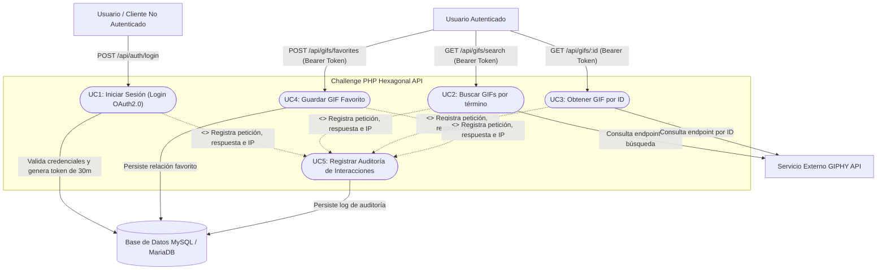
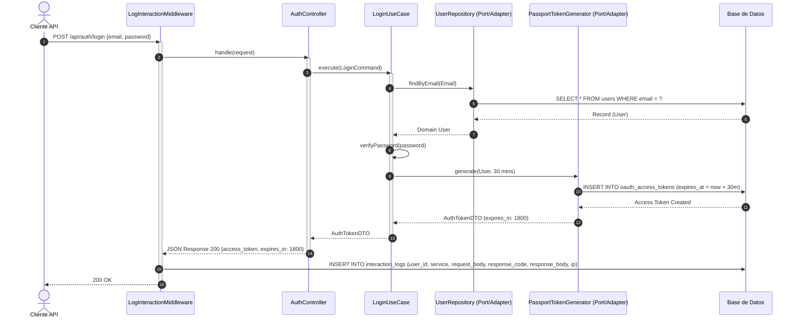
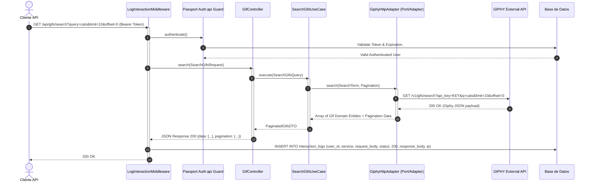
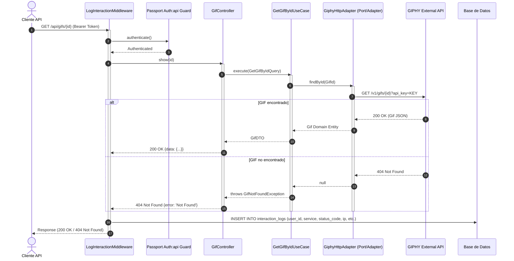
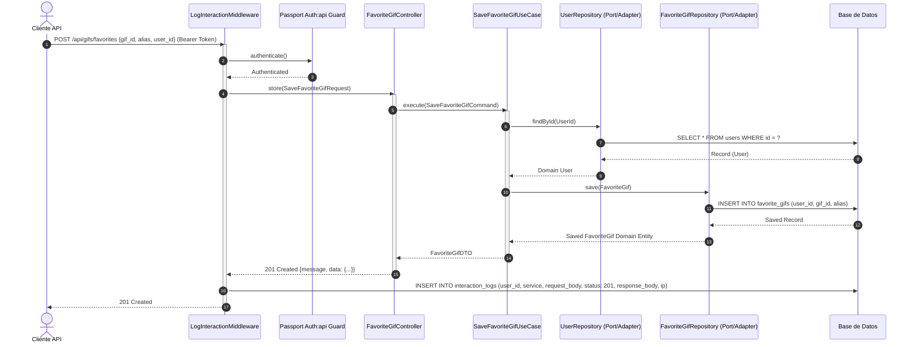
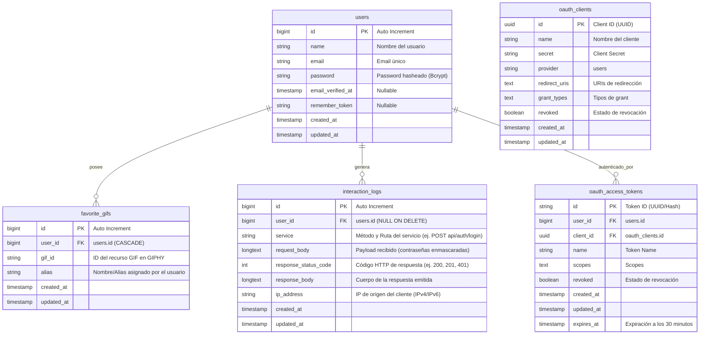

# Challenge PHP Hexagonal + DDD API

API REST construida bajo los principios de **Arquitectura Hexagonal (Ports & Adapters)** y **Diseño Guiado por el Dominio (DDD)** en **PHP 8.5+** y **Laravel 13+**, integrada con la API de **GIPHY** y autenticación **OAuth 2.0 (Laravel Passport)** con expiración estricta de tokens a los 30 minutos.

---

## 📑 Tabla de Contenidos
1. [Características Principales](#-características-principales)
2. [Arquitectura del Proyecto](#-arquitectura-del-proyecto)
3. [Requisitos Previos](#-requisitos-previos)
4. [Despliegue con Docker](#-despliegue-con-docker-recomendado)
5. [Instalación Local](#-instalación-local-sin-docker)
6. [Colección POSTMAN y Automatización de Token](#-colección-postman-y-automatización-de-token)
7. [Endpoints de la API](#-endpoints-de-la-api)
8. [Auditoría de Interacciones (Persistencia de Logs)](#-auditoría-de-interacciones-persistencia-de-logs)
9. [Ejecución de Tests](#-ejecución-de-tests)
10. [Diagrama de Casos de Uso](#-diagrama-de-casos-de-uso)
11. [Diagrama de Secuencia](#-diagrama-de-secuencia-todos-los-casos-de-uso)
12. [Diagrama de Datos (DER)](#-diagrama-de-datos-der)

---

## 🚀 Características Principales

- **Arquitectura Hexagonal + DDD**: Separación estricta en capas `Domain`, `Application` e `Infrastructure`. El dominio y la aplicación no dependen de la infraestructura ni del framework.
- **Acceso a Datos desacoplado**: La persistencia se realiza exclusivamente a través de puertos/interfaces del dominio (`UserRepositoryInterface`, `FavoriteGifRepositoryInterface`, `InteractionLogRepositoryInterface`). Los controladores jamás interactúan directamente con Eloquent.
- **Autenticación OAuth 2.0**: Implementada con **Laravel Passport**, emitiendo tokens Bearer con tiempo de vida estricto de **30 minutos**.
- **Integración con GIPHY**: Adaptador HTTP desacoplado (`GiphyHttpAdapter`) para búsquedas de GIFs y consulta de GIFs por ID.
- **Auditoría Global de Peticiones**: Middleware (`LogInteractionMiddleware`) que persiste en base de datos el usuario, servicio consultado, cuerpo de petición (con contraseñas enmascaradas), código HTTP, cuerpo de respuesta e IP de origen.
- **Cobertura de Tests Exhaustiva**: 53 pruebas (Unitarias y Feature) con 168 aserciones cubriendo lógica de negocio aislada y endpoints HTTP.
- **Docker Ready**: `Dockerfile` optimizado y orquestación con `docker-compose.yml` para **PHP 8.5** y MySQL 8.0, con **Laravel 13**.

---

## 🏛 Arquitectura del Proyecto

El código fuente sigue la siguiente estructura hexagonal dentro de `app/`:

```text
app/
├── Domain/                           # Reglas de negocio puras (independientes del framework)
│   ├── Auth/
│   │   ├── Entities/User.php
│   │   ├── Exceptions/InvalidCredentialsException.php, UserNotFoundException.php
│   │   ├── Repositories/UserRepositoryInterface.php (Puerto)
│   │   └── ValueObjects/Email.php, UserId.php
│   ├── Gif/
│   │   ├── Entities/Gif.php
│   │   ├── Exceptions/GifNotFoundException.php, GiphyApiException.php
│   │   ├── Ports/GiphyGatewayInterface.php (Puerto)
│   │   └── ValueObjects/GifId.php, SearchTerm.php, Pagination.php
│   ├── FavoriteGif/
│   │   ├── Entities/FavoriteGif.php
│   │   ├── Repositories/FavoriteGifRepositoryInterface.php (Puerto)
│   │   └── ValueObjects/Alias.php
│   └── InteractionLog/
│       ├── Entities/InteractionLog.php
│       └── Repositories/InteractionLogRepositoryInterface.php (Puerto)
├── Application/                      # Casos de uso y orquestación
│   ├── Auth/
│   │   ├── Commands/LoginCommand.php
│   │   ├── DTOs/AuthTokenDTO.php
│   │   ├── Ports/TokenGeneratorInterface.php (Puerto)
│   │   └── UseCases/LoginUseCase.php
│   ├── Gif/
│   │   ├── DTOs/GifDTO.php, PaginatedGifsDTO.php
│   │   ├── Queries/SearchGifsQuery.php, GetGifByIdQuery.php
│   │   └── UseCases/SearchGifsUseCase.php, GetGifByIdUseCase.php
│   ├── FavoriteGif/
│   │   ├── Commands/SaveFavoriteGifCommand.php
│   │   ├── DTOs/FavoriteGifDTO.php
│   │   └── UseCases/SaveFavoriteGifUseCase.php
│   └── InteractionLog/
│       ├── Commands/LogInteractionCommand.php
│       └── UseCases/LogInteractionUseCase.php
└── Infrastructure/                   # Adaptadores de infraestructura
    ├── Adapters/
    │   ├── External/Giphy/GiphyHttpAdapter.php (Adaptador de Giphy)
    │   └── Persistence/Eloquent/
    │       ├── Models/FavoriteGifModel.php, InteractionLogModel.php
    │       └── Repositories/
    │           ├── EloquentUserRepository.php (Implementación de Puerto)
    │           ├── EloquentFavoriteGifRepository.php (Implementación de Puerto)
    │           └── EloquentInteractionLogRepository.php (Implementación de Puerto)
    ├── Auth/PassportTokenGenerator.php (Implementación de TokenGenerator)
    ├── Http/
    │   ├── Controllers/AuthController.php, GifController.php, FavoriteGifController.php
    │   ├── Middleware/LogInteractionMiddleware.php (Auditoría de peticiones)
    │   └── Requests/LoginRequest.php, SearchGifsRequest.php, SaveFavoriteGifRequest.php
    └── Providers/HexagonalServiceProvider.php (Inyección de dependencias)
```

---

## 📋 Requisitos Previos

- **Docker** y **Docker Compose** (opción recomendada)
- O en su defecto para ejecución nativa:
  - PHP >= 8.5 con extensiones `pdo_mysql`, `pdo_sqlite`, `curl`, `mbstring`, `xml`, `zip`.
  - Composer 2.x
  - MySQL 8.0 o MariaDB

---

## 🐳 Despliegue con Docker (Recomendado)

El proyecto incluye configuración completa de Docker y un script de inicialización automática que ejecuta migraciones, genera claves de OAuth2/Passport y crea el usuario por defecto.

1. **Clonar el proyecto y ubicarse en el directorio:**
   ```bash
   git clone git@github.com:generic-user-95/prex-challenge.git
   cd prex-challenge
   ```

2. **Configurar variables de entorno (opcional):**
   ```bash
   cp .env.example .env
   ```
   *(Si tienes tu propia clave de GIPHY, agrégala en `.env` en `GIPHY_API_KEY=tu_api_key`. De lo contrario, puedes consultar los servicios y ejecutar tests sin inconvenientes).*

3. **Levantar los contenedores:**
   ```bash
   docker compose up --build -d
   ```

   El servicio web quedará expuesto inmediatamente en:
   👉 **`http://localhost:8000`**

4. **Credenciales iniciales generadas automáticamente por el seeder:**
   - **Email:** `admin@challenge.com`
   - **Password:** `password123`

---

## 💻 Instalación Local (Sin Docker)

Si prefieres ejecutar el proyecto localmente con PHP nativo:

```bash
# 1. Instalar dependencias
composer install

# 2. Configurar entorno
cp .env.example .env
php artisan key:generate

# 3. Ejecutar migraciones y seeders
php artisan migrate --force
php artisan passport:keys --force
php artisan passport:client --personal --name="Personal Access Client"
php artisan db:seed --force

# 4. Iniciar servidor de desarrollo
php artisan serve --port=8000
```

---

## 📬 Colección POSTMAN y Automatización de Token

Se incluyen dos archivos listos para importar en Postman:
- `postman_collection.json`: Colección con todos los endpoints documentados, payloads de ejemplo y tests automatizados.
- `postman_environment.json`: Variables de entorno (`base_url`, `user_email`, `user_password`, `token`, `user_id`).

### ⚡ Automatización del Token:
Al ejecutar la petición **Login (Generate OAuth2 Token)**, el script de tests integrado en Postman extrae automáticamente el `access_token` de la respuesta y lo guarda en la variable de entorno `token`:

```javascript
// Postman Tests Script en Login:
var jsonData = pm.response.json();
if (jsonData.access_token) {
    pm.environment.set("token", jsonData.access_token);
    pm.environment.set("user_id", jsonData.user ? jsonData.user.id : 1);
    console.log("Token automatically stored in environment variable 'token'");
}
```

Todas las solicitudes posteriores (**Buscar GIFs**, **Buscar GIF por ID**, **Guardar Favorito**) ya vienen configuradas con `Authorization: Bearer {{token}}`, permitiendo una ejecución fluida e inmediata sin copiar y pegar tokens manualmente.

---

## 🔌 Endpoints de la API

### 1. Autenticación (Login)
- **Método / URL:** `POST /api/auth/login` (o alias `POST /api/login`)
- **Headers:** `Content-Type: application/json`, `Accept: application/json`
- **Body:**
  ```json
  {
    "email": "admin@challenge.com",
    "password": "password123"
  }
  ```
- **Respuesta (200 OK):**
  ```json
  {
    "access_token": "eyJ0eXAiOiJKV1QiLCJhbGci...",
    "token_type": "Bearer",
    "expires_in": 1800,
    "expires_at": "2026-10-21T18:30:00+00:00",
    "user": {
      "id": 1,
      "email": "admin@challenge.com",
      "name": "Challenge Admin"
    }
  }
  ```
- **Errores:**
  - `401 Unauthorized`: Credenciales inválidas.
  - `422 Unprocessable Content`: Validación de campos fallida.

---

### 2. Buscar GIFs
- **Método / URL:** `GET /api/gifs/search`
- **Headers:** `Authorization: Bearer {{token}}`, `Accept: application/json`
- **Query Params:**
  - `query` *(requerido | cadena)*: Frase o término de búsqueda (ej. `cat`).
  - `limit` *(opcional | numérico)*: Cantidad de resultados (1 a 50, defecto: 25).
  - `offset` *(opcional | numérico)*: Índice de paginación (defecto: 0).
- **Ejemplo:** `GET /api/gifs/search?query=funny+cat&limit=10&offset=0`
- **Respuesta (200 OK):**
  ```json
  {
    "data": [
      {
        "id": "3o7TKxGqQz9h6yZ1qA",
        "title": "Funny Cat GIF",
        "url": "https://giphy.com/gifs/3o7TKxGqQz9h6yZ1qA",
        "embed_url": "https://giphy.com/embed/3o7TKxGqQz9h6yZ1qA",
        "rating": "g",
        "images": {
          "original": {
            "url": "https://media.giphy.com/media/3o7TKxGqQz9h6yZ1qA/giphy.gif"
          }
        }
      }
    ],
    "pagination": {
      "total_count": 500,
      "count": 10,
      "offset": 0
    }
  }
  ```
- **Errores:**
  - `401 Unauthorized`: Token faltante o expirado.
  - `422 Unprocessable Content`: Si falta el parámetro `query`.

---

### 3. Buscar GIF por ID
- **Método / URL:** `GET /api/gifs/{id}`
- **Headers:** `Authorization: Bearer {{token}}`, `Accept: application/json`
- **Ejemplo:** `GET /api/gifs/3o7TKxGqQz9h6yZ1qA`
- **Respuesta (200 OK):**
  ```json
  {
    "data": {
      "id": "3o7TKxGqQz9h6yZ1qA",
      "title": "Funny Cat GIF",
      "url": "https://giphy.com/gifs/3o7TKxGqQz9h6yZ1qA",
      "embed_url": "https://giphy.com/embed/3o7TKxGqQz9h6yZ1qA",
      "rating": "g",
      "images": { ... }
    }
  }
  ```
- **Errores:**
  - `401 Unauthorized`: No autenticado.
  - `404 Not Found`: El recurso GIF solicitado no existe.

---

### 4. Guardar GIF Favorito
- **Método / URL:** `POST /api/gifs/favorites` (o alias `POST /api/favorites`)
- **Headers:** `Authorization: Bearer {{token}}`, `Content-Type: application/json`, `Accept: application/json`
- **Body:**
  ```json
  {
    "gif_id": "3o7TKxGqQz9h6yZ1qA",
    "alias": "Mi Gato Favorito",
    "user_id": 1
  }
  ```
- **Respuesta (201 Created):**
  ```json
  {
    "message": "Favorite GIF saved successfully.",
    "data": {
      "id": 1,
      "user_id": 1,
      "gif_id": "3o7TKxGqQz9h6yZ1qA",
      "alias": "Mi Gato Favorito",
      "created_at": "2026-10-21T18:35:00+00:00"
    }
  }
  ```
- **Errores:**
  - `401 Unauthorized`: No autenticado.
  - `404 Not Found`: Si el `user_id` especificado no existe en la base de datos.
  - `422 Unprocessable Content`: Validación de campos incorrecta.

---

## 🛡 Auditoría de Interacciones (Persistencia de Logs)

Cumpliendo estrictamente con el requerimiento de la consigna:
> *"Toda la interacción con los servicios deberá persistirse registrando: Usuario que realizó la petición, Servicio consultado, Cuerpo de la petición, Código HTTP de la respuesta, Cuerpo de la respuesta, IP de origen de la consulta."*

El middleware `LogInteractionMiddleware` intercepta todas las peticiones a la API y persiste un registro en la tabla `interaction_logs` conteniendo:
- `user_id`: ID del usuario autenticado (o `null` si no está autenticado).
- `service`: Verbo HTTP y ruta consultada (ej. `POST api/auth/login`, `GET api/gifs/search`).
- `request_body`: Parámetros recibidos (JSON), con enmascaramiento de campos sensibles (`password: '********'`).
- `response_status_code`: Código HTTP (ej. 200, 201, 401, 404, 422).
- `response_body`: Contenido JSON devuelto al cliente.
- `ip_address`: Dirección IP del cliente solicitante.
- `created_at`: Timestamp de la operación.

---

## 🧪 Ejecución de Tests

El proyecto cuenta con una suite completa de **53 pruebas** (unitarias y feature) con **168 aserciones**.

### 🐳 Con Docker (Recomendado)

La forma recomendada es ejecutar los tests **dentro del contenedor en ejecución**, ya que dispone de MySQL, todas las extensiones PHP y las variables de entorno correctas:

```bash
# 1. Levantar los contenedores (si no están ya en ejecución)
docker compose up -d

# 2. Ejecutar la suite completa (53 tests, 168 aserciones)
docker compose exec app php artisan test

# 3. Ejecutar solo los tests unitarios
docker compose exec app php artisan test --testsuite=Unit

# 4. Ejecutar solo los tests de feature
docker compose exec app php artisan test --testsuite=Feature
```

También puedes ejecutar los tests en un contenedor efímero (sin `docker compose up`):

```bash
# Construir la imagen primero (si no existe)
docker compose build

# Ejecutar en contenedor temporal (usa SQLite en memoria para los feature tests)
docker run --rm challenge_php_app:latest php artisan test
```

### 💻 Sin Docker (Solo Tests Unitarios)

Para ejecutar localmente sin Docker se requiere **PHP >= 8.5** con las extensiones necesarias. En este caso solo los tests unitarios están disponibles (los feature tests requieren MySQL):

```bash
# Instalar dependencias
composer install

# Ejecutar únicamente los tests unitarios (33 tests)
php artisan test --testsuite=Unit

# O directamente con PHPUnit
./vendor/bin/phpunit --testsuite=Unit
```

> **Nota:** Los feature tests requieren una base de datos MySQL activa. Para ejecutarlos sin Docker, configura `.env` con tus credenciales MySQL locales y ejecuta las migraciones antes de correr `php artisan test --testsuite=Feature`.

### Resumen de la Suite:
- **Unit Tests:** Cobertura de entidades de dominio (`User`, `Gif`, `FavoriteGif`, `InteractionLog`), Value Objects (`Email`, `UserId`, `GifId`, `SearchTerm`, `Pagination`, `Alias`), casos de uso y puertos con mocks aislados.
- **Feature Tests:** Pruebas completas de ciclo de vida de los endpoints HTTP, autenticación OAuth2.0, validaciones 422, respuestas 401/404 y persistencia de auditoría de interacciones.

---

## 📊 Diagrama de Casos de Uso



---

## 🔄 Diagrama de Secuencia (Todos los Casos de Uso)

### 1. Iniciar Sesión (Login OAuth2.0 - Expiración 30 min)


### 2. Buscar GIFs por Frase / Término


### 3. Obtener GIF por ID


### 4. Guardar GIF Favorito


---

## 🗄 Diagrama de Datos (DER)


