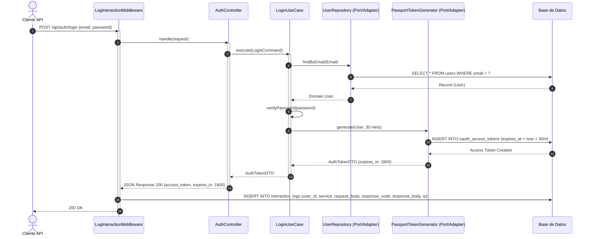
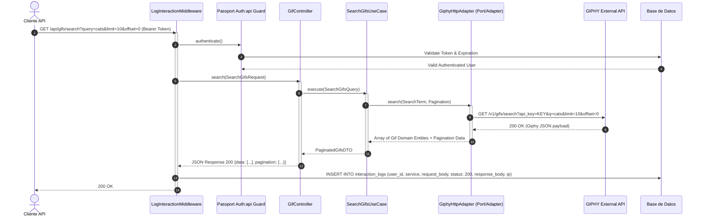
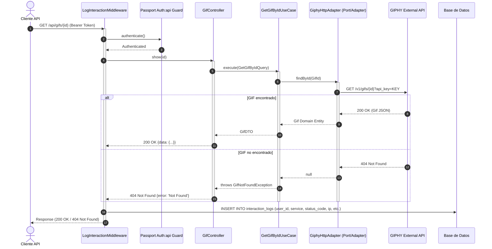
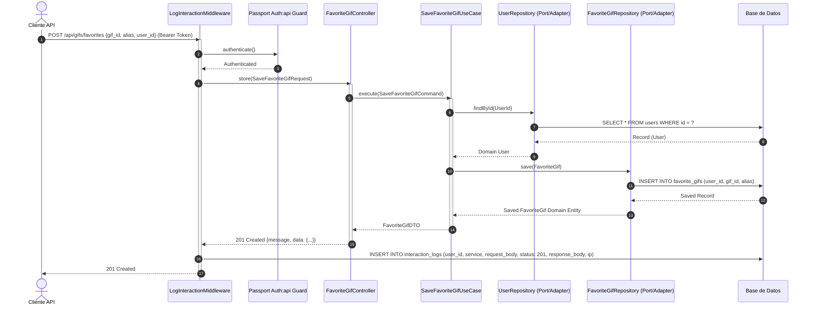

# Diagramas de Secuencia (Todos los Casos de Uso)

## 1. UC1: Login (OAuth2.0 con expiración de 30 minutos)

## 2. UC2: Buscar GIFs por Término

## 3. UC3: Buscar GIF por ID

## 4. UC4: Guardar GIF Favorito

